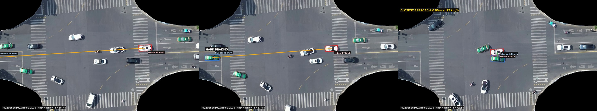
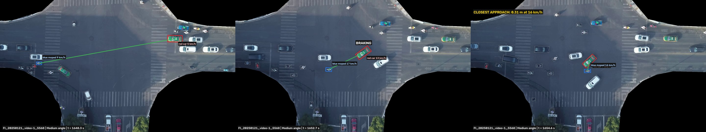
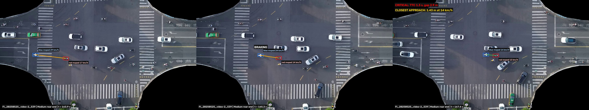
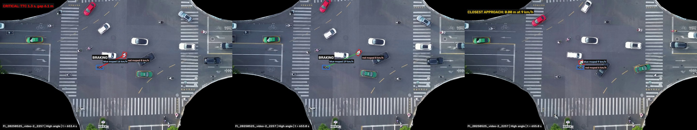

# PNMIDS: near-miss detection and identification at signalised junctions

Layer 3 of the PNMIDS safety engine, run on real drone trajectories, validated against
human labels, and (v2) extended from *detecting* a near-miss to *identifying* it:
which road user did what, in which frame, and which action made the scene a near-miss.

Data: [FLUID](https://github.com/sysu19351014/FLUID) (Sun Yat-sen University; Figshare
doi:10.6084/m9.figshare.29974954; arXiv:2509.00497). FLUID provides drone video and
YOLOv8 (OBB) + SparseTrack trajectories. The data is not included here; download it from Figshare.

## What is in this repository

| Folder | Contents |
| --- | --- |
| `pnmids/` | The engine and tools (Python package) |
| `results_v2/` | Engine events, dataset comparison, ablation, WP3 tables and figures |
| `results_v2/explained/` | v2 identification of the 20 highest-risk High events at the FI junction |
| `labels/` | 120 human-labelled clips (consensus, probability-based) joined to engine output |

## Versions

**v1 / v2 engine (detection).** TTC (rear-end, constant velocity, turning CTRV), PET grid,
DRAC and Delta-V; severity High / Medium / Low; Critique Agent; signal and turn context.
v2 adds real body shapes (circle chains from measured length and width), a 0.3 m/s closing-speed
gate, a lateral gate for parallel traffic, and a junction box estimated from the data.

**v3 refinement (calibration).** `p_real`, the probability a person would call the event a real
near-miss, calibrated on the human labels; observed minimum gap; overtake flag.

**v2 identification (this release).** `explain.py` rebuilds every event frame by frame and finds:

- per frame: gap between the two bodies, constant-velocity TTC, both speeds
- behaviour events per road user, each with its frame: entered on red / amber (from the
  dataset's route and signal data), braking and hard braking (sustained deceleration),
  sharp acceleration, swerve while going straight, overtaking
- milestones: conflict starts (TTC < 3 s), critical (TTC < 1.5 s), minimum TTC, closest approach
- a rule-based attribution: **cause -> response -> outcome**, written as one sentence, e.g.
  *"HIGH head on near-miss: red car turned left across the path of blue car. Response: blue car
  hard braking (48 to 14 km/h in 3.6 s, peak -3.8 m/s2), 4.6 s before closest approach.
  Outcome: closest gap 0.00 m, minimum TTC 0.90 s."*

`make_event_video.py` renders each event as an annotated video: the two road users boxed in
red and blue, a line between them coloured by live TTC, every behaviour tagged on the frame it
happens, and a panel with the explanation, live TTC / gap / speeds and a timeline.

## Setup

```
python3 -m venv .venv && source .venv/bin/activate
pip install -r requirements.txt
```
Layout expected by the commands (paths are arguments, so any layout works):
```
data/FI/derived_data/{traj,route,signal,conflict}/   FLUID derived data
FI/video/*.mp4                                         FLUID videos
```

## Commands

| Step | Command | Time (laptop) |
| --- | --- | --- |
| Run the engine | `python -m pnmids.run_pipeline --data data/FI/derived_data --site FI --out results_v2` | ~6 min |
| Calibrate (v3) | `python -m pnmids.refine --events results_v2/FI_events.csv --traj-dir data/FI/derived_data/traj --out results_v2/FI_events_refined.csv` | ~4 min |
| Identify (v2) | `python -m pnmids.explain --events results_v2/FI_events.csv --traj-dir data/FI/derived_data/traj --top 20 --out results_v2/explained` | ~3 min |
| Annotated videos (v2) | `python -m pnmids.make_event_video --events results_v2/FI_events.csv --traj-dir data/FI/derived_data/traj --video-dir FI/video --out videos_v2 --top 5` | ~30 s per event |
| Review clips | `python -m pnmids.make_clips --events results_v2/FI_events.csv --traj-dir data/FI/derived_data/traj --video-dir FI/video --out clips/FI --n 60 --zone junction --blind` | ~10 min |

Use `--event-ids <id> <id>` instead of `--top N` for chosen events.

## Key results (FI and FIDRT, 3.8 h of video)

- The engine finds 83% of the dataset's own conflict list; type agrees 84%.
- Against 120 human-labelled clips: High 51% real, Medium 24%, Low 1%, Critique-rejected 4%.
  About 6 in 10 High or Medium alerts are not real near-misses: thresholds need tuning for mixed traffic.
- Overtakes, which the engine labels rear-end, are the riskiest same-direction events (52% vs 19% real).
- Calibrated estimate: about 200 real near-misses per hour at the FI junction, against about 675 alerts.
- v2 identification: in 17 of the 20 highest-risk junction events, one road user turned left across
  oncoming traffic.

## Limitations

Small labelled sample (120 clips, one junction); consensus labels without an agreement score;
assumed sizes and masses for mopeds, trucks and buses; behaviour thresholds in `explain.py`
(braking, acceleration, swerve) are engineering defaults that still need validation against labels.

## Demo: annotated near-miss videos (v2)

Each video shows the two road users (red, blue), a line coloured by live TTC, every action tagged on the frame it happens, and the cause -> response -> outcome explanation.

| Event | Storyboard (cause, response, closest approach) | Video |
| --- | --- | --- |
| Head-on, left turn across, hard braking |  | [video](docs/demo/FI_20250530_video-1_105.mp4) |
| Angle, left turn across a moped |  | [video](docs/demo/FI_20250121_video-1_5568.mp4) |
| Rear end, moped braking |  | [video](docs/demo/FI_20250525_video-2_539.mp4) |
| Angle, moped braking |  | [video](docs/demo/FI_20250525_video-2_2257.mp4) |
